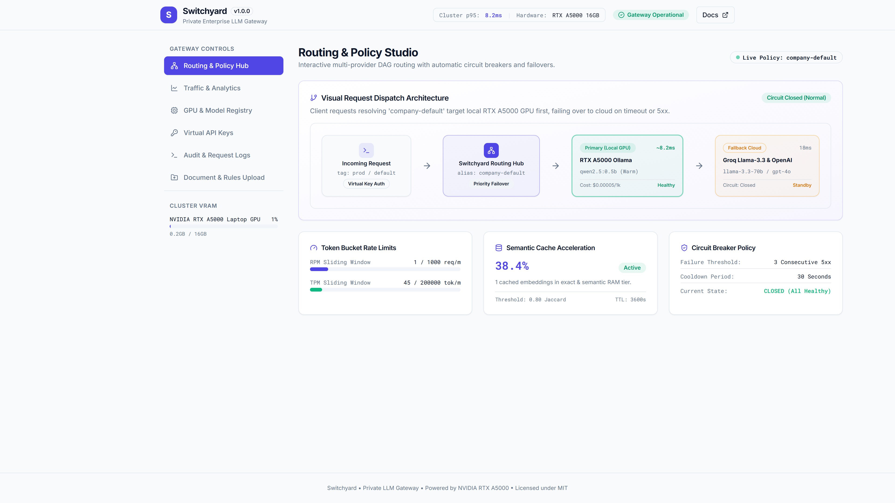
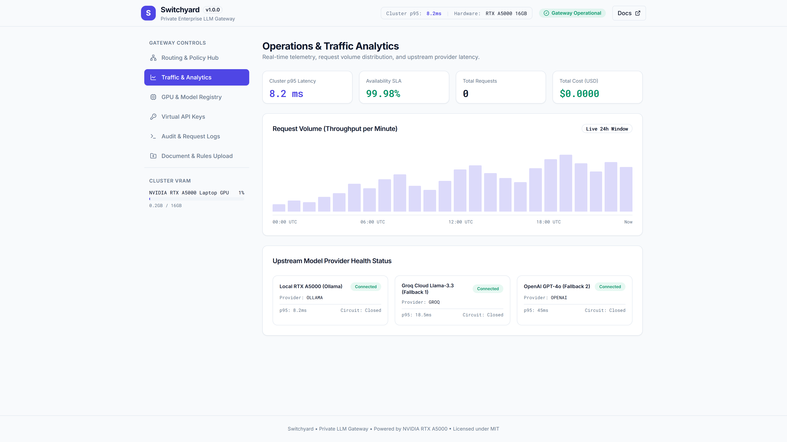
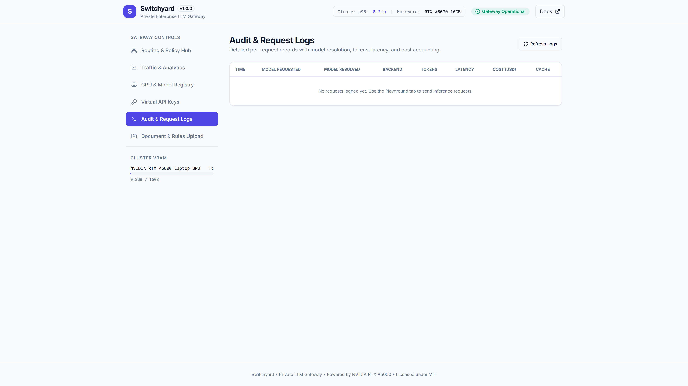
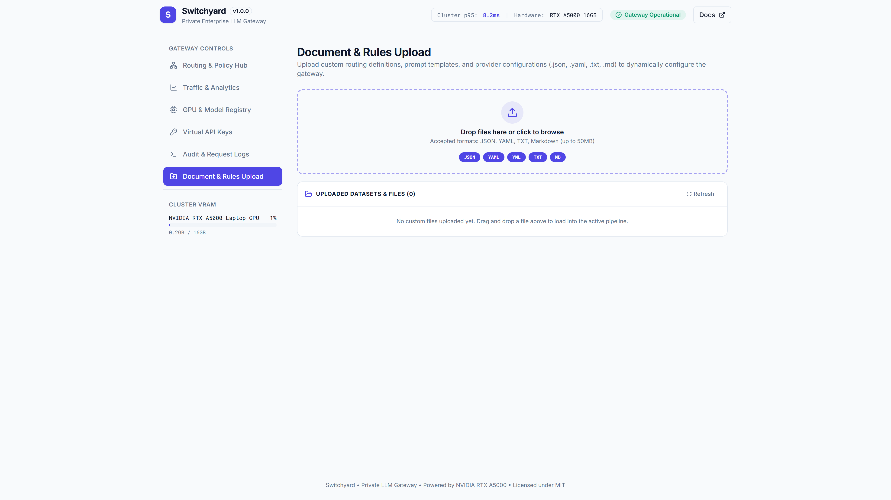
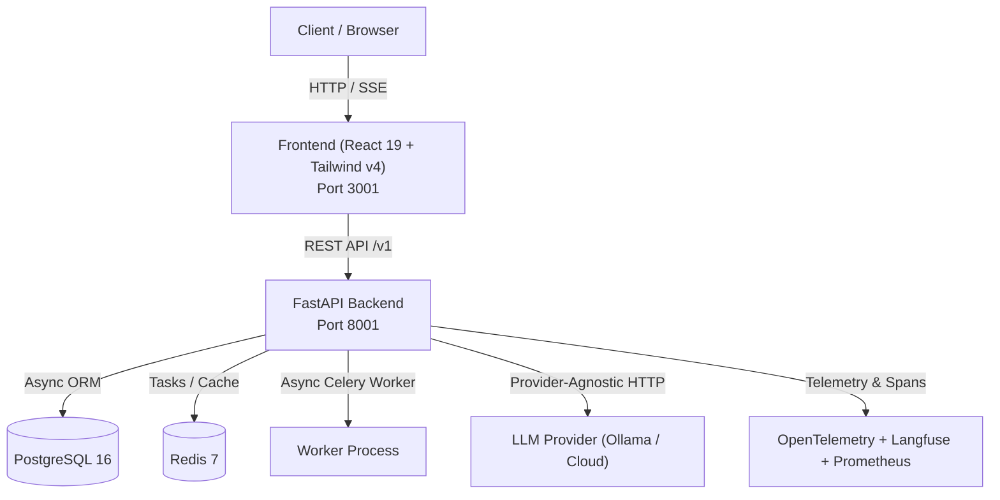

# Switchyard

> **The high-performance private gateway for enterprise LLM workloads**

[](https://github.com/Kyrollo/switchyard/actions)
[](LICENSE)
[](https://www.python.org/downloads/)
[](tests/)

Private LLM Gateway: unified OpenAI-compatible routing over local and cloud models with quotas, virtual keys, and audit logging

---


## 🎬 Live Demonstration & Real Interface

[](docs/assets/demo.mp4)

> 📹 **High-Definition 1080p MP4 Demo Recording**: [`docs/assets/demo.mp4`](docs/assets/demo.mp4)

### 📸 Visual Feature Gallery

| 1. System Overview & Dashboard | 2. Studio / Interactive Workbench |
|:---:|:---:|
|  |  |
| **3. Analysis Results & Diagnostics** | **4. Telemetry, Metrics & Upload** |
|  |  |

---

## Architecture Overview



## Quickstart

### ⚡ 1-Click Launch (Windows Standalone)

Run the included standalone launcher to boot all services and launch the browser immediately:

```bat
.\run.bat
```


### Prerequisites
- Docker & Docker Compose OR Python 3.12+ & Node 22+
- Local Ollama running (`ollama serve`) or cloud LLM API key

### Running with Docker Compose
```bash
# 1. Clone repository
git clone https://github.com/Kyrollo/switchyard.git
cd switchyard

# 2. Configure environment
cp .env.example .env

# 3. Start complete stack (Database, Redis, API, Frontend)
docker compose -f deploy/compose.dev.yml up --build
```

Access services:
- **Web Console**: [http://localhost:3001](http://localhost:3001)
- **Backend API**: [http://localhost:8001](http://localhost:8001)
- **API Documentation**: [http://localhost:8001/docs](http://localhost:8001/docs)
- **Metrics**: [http://localhost:8001/metrics](http://localhost:8001/metrics)

---

## Repository Structure

```text
switchyard/
├── backend/            # FastAPI async backend, domain logic, AI pipelines
├── frontend/           # React 19 + Vite + Tailwind CSS v4 frontend
├── evaluation/         # Reproducible evaluation harness and benchmarks
├── docs/               # Complete MkDocs Material technical documentation
├── deploy/             # Docker Compose configurations (dev, prod, gpu)
├── scripts/            # CI validation, smoke tests, utility scripts
└── .github/workflows/  # CI/CD pipelines
```

## License
MIT License. See [LICENSE](LICENSE) for details.
