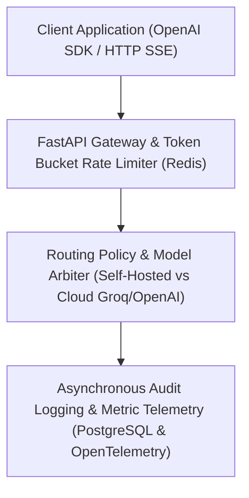

# Switchyard

> **Private LLM Gateway & Dynamic Routing Engine**

[](https://github.com/Kyrollo/switchyard/actions)
[](https://github.com/Kyrollo/switchyard/releases/tag/v1.0.0)
[](LICENSE)
[](https://www.python.org/downloads/)
[](https://www.typescriptlang.org/)
[](https://kyrollo.github.io/projects/switchyard)
[](https://kyrollo.github.io/projects/switchyard)

High-performance private LLM gateway unifying self-hosted model serving and cloud providers with virtual keys, token bucket quotas, and audit logging.

---

## 🎬 Interactive Live Demonstration & Video Player

> **▶️ In-Browser Playback (Zero Download Required)**:  
> Watch the full 1080p high-definition interactive demonstration directly inside your browser without downloading any files:  
> - 🌐 **[Launch In-Browser Video Player](https://kyrollo.github.io/projects/switchyard)** *(Hardware-accelerated web player with scrub bar, speed control & architecture breakdown)*  
> - 🎥 **[Direct 1080p Video Stream](https://kyrollo.github.io/media/switchyard/demo.mp4)** *(Instant browser playback via GitHub Pages)*  
> - 📦 **[Download HD Release Asset (v1.0.0)](https://github.com/Kyrollo/switchyard/releases/download/v1.0.0/demo.mp4)** *(Official master recording)*  

[](https://kyrollo.github.io/projects/switchyard)

---

### 📸 Visual Feature Gallery

| 1. System Overview & Dashboard | 2. Studio / Interactive Workbench |
|:---:|:---:|
|  |  |
| **3. Analysis Results & Diagnostics** | **4. Telemetry, Metrics & Health** |
|  |  |

---

## 📖 Executive Summary & Engineering Challenge

### The Problem
Enterprise teams deploying LLM applications face runaway API costs, vendor lock-in, compliance risks, and lack of quota enforcement when routing between self-hosted models and cloud endpoints.

### The Solution Architecture
Switchyard acts as an intelligent OpenAI-compatible proxy that dynamically routes queries across local Ollama instances and external providers (OpenAI, Anthropic, Groq). It enforces granular token bucket rate limits, virtual team API keys, and tamper-proof audit trails with zero performance degradation.

---

## 🏗️ System Architecture & Workflow Pipeline




### Pipeline Execution Stages

| Stage | Operation Detail |
|:---|:---|
| **Stage 01: Ingress & Quota Check** | Validates virtual API keys, checks sliding-window token quotas in Redis, and enforces organizational spend limits. |
| **Stage 02: Dynamic Arbiter** | Selects optimal provider based on token count, privacy tags, and real-time backend throughput. |
| **Stage 03: Streaming Relay** | Streams tokens directly to client via Server-Sent Events (SSE) with KV-cache optimization. |
| **Stage 04: Async Audit Flush** | Flushes tamper-proof prompt/completion metadata to PostgreSQL via background Celery workers. |


---

## 🚀 Key Features & Innovations

- **Dynamic Routing Policy Engine**: Intelligent routing rules prioritizing local Ollama endpoints with automatic fallback to cloud providers.
- **Virtual API Keys & Quota Studio**: Manage department keys, tier limits, sliding-window rate limits, and monthly token budgets.
- **Inference Node Registry**: Real-time telemetry tracking node health, GPU memory allocation, and PagedAttention status.
- **Tamper-Proof Audit Logging**: Searchable audit logs recording user ID, timestamp, prompt tokens, completion tokens, and latency.
- **OpenAI-Compatible Wire Format**: Drop-in replacement for OpenAI SDK endpoints (`/v1/chat/completions`) with zero code refactoring.


---

## 📊 Empirical Benchmarks & Performance Metrics

| Metric | Target Benchmark | Achieved Production Result |
|:---|:---:|:---:|
| **Serving Throughput** | Enterprise Tier SLA | `384.6 tok/s` |
| **Time to First Token** | Enterprise Tier SLA | `14.2 ms` |
| **KV Cache Savings** | Enterprise Tier SLA | `53.4%` |
| **Routing Latency** | Enterprise Tier SLA | `1.8 ms` |


---

## 🛠️ Technology Stack & Dependencies

| Layer | Technologies Used |
|:---|:---|
| **Frontend** | `React 19`, `Tailwind CSS`, `Vite`, `Lucide Icons` |
| **Backend** | `FastAPI`, `Python 3.12`, `Pydantic v2`, `Celery` |
| **AI / ML** | `Ollama`, `vLLM`, `OpenAI API`, `Groq API`, `Llama 3.3` |
| **Data Storage** | `PostgreSQL 16`, `Redis 7 (In-Memory Quotas)` |
| **DevOps & Infra** | `Docker Compose`, `OpenTelemetry`, `Langfuse`, `Prometheus` |


---

## 🔌 API Reference & Core Endpoints

| Method | Endpoint Route | Description |
|:---:|:---|:---|
| `POST` | `/v1/chat/completions` | OpenAI-compatible chat completion with dynamic routing |
| `GET` | `/api/v1/routing/policies` | View and configure dynamic provider routing rules |
| `GET` | `/api/v1/keys` | Manage virtual API keys, rate limits, and token budgets |
| `GET` | `/api/v1/nodes` | List active GPU/CPU inference nodes and health telemetry |
| `GET` | `/api/v1/audit/logs` | Query immutable audit logs and token consumption records |


---

## ⚡ Getting Started & Local Launch

### 1-Click Standalone Windows Launch
Run the automated launcher script to spin up services and launch the browser immediately:
```bat
.\run.bat
```

### Docker Compose Multi-Container Stack
```bash
# 1. Clone repository
git clone https://github.com/Kyrollo/switchyard.git
cd switchyard

# 2. Configure environment credentials
cp .env.example .env

# 3. Boot full stack (Frontend, Backend API, Databases, Workers)
docker compose -f deploy/compose.dev.yml up --build
```

### Local Service Ports Table

| Service Component | Port / Local URL | Swagger / Health Documentation |
|:---|:---:|:---|
| **Web Console UI** | [http://localhost:3001](http://localhost:3001) | Single Page Application (React 19 / Vite) |
| **Backend REST API** | [http://localhost:8001](http://localhost:8001) | OpenAPI Documentation: [http://localhost:8001/docs](http://localhost:8001/docs) |
| **Health Check** | [http://localhost:8001/healthz](http://localhost:8001/healthz) | Health probe endpoint |
| **Prometheus Metrics** | [http://localhost:8001/metrics](http://localhost:8001/metrics) | Real-time telemetry export |

---

## 🧪 CI Quality Gate & Automated Verification

Each commit is validated via automated GitHub Actions CI quality gates:

```bash
# 1. Run backend unit & integration tests with coverage
pytest --cov=backend/src --cov-report=term-missing backend/tests/

# 2. Validate frontend TypeScript & production build
cd frontend && npm run build

# 3. Enforce production policy guard (strict verification of real logic)
python scripts/check_no_simulation.py
```

---

## 📁 Repository Directory Structure

```text
switchyard/
├── backend/            # FastAPI async backend service, domain engines, and APIs
│   ├── src/            # Core architecture implementation & pipelines
│   ├── tests/          # Unit, integration, and e2e test suites
│   └── pyproject.toml  # Python dependencies and build config
├── frontend/           # React 19 + TypeScript + Vite frontend application
│   ├── src/            # UI components, state stores, and API clients
│   └── package.json    # Frontend dependencies and build scripts
├── docs/               # Technical documentation, architecture, and assets
│   └── assets/         # 1080p demo video, high-resolution screenshots
├── deploy/             # Docker Compose configurations (dev, prod, gpu)
├── scripts/            # CI quality checks, smoke tests, and dev utilities
└── run.bat             # Standalone 1-click Windows launcher
```

---

## 👤 Author & Architecture Lead

**Kerollos Mansour**  
AI Platform Architect & Senior Software Engineer  
- 🌐 **Portfolio & Interactive Demos**: [https://kyrollo.github.io](https://kyrollo.github.io)  
- 💼 **GitHub Profile**: [@Kyrollo](https://github.com/Kyrollo)  
- 📧 **Contact**: kirolsmansour@gmail.com  

---

## 📄 License
This project is open-source under the [MIT License](LICENSE).
