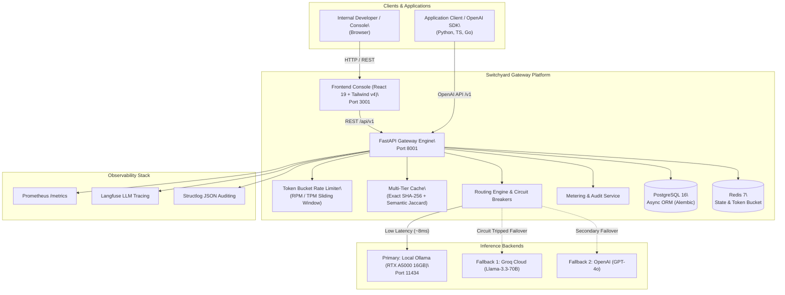
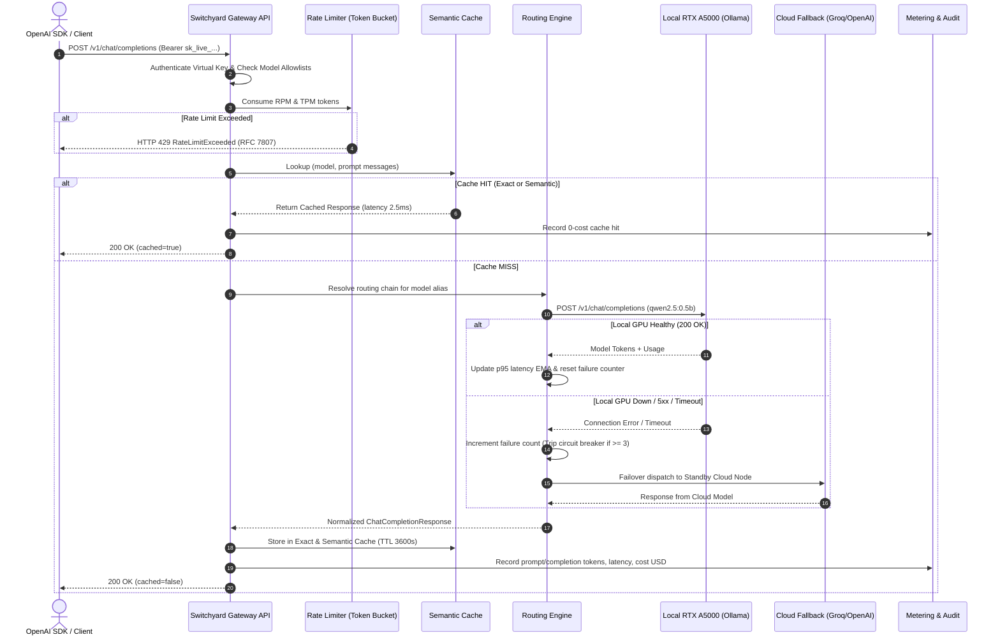
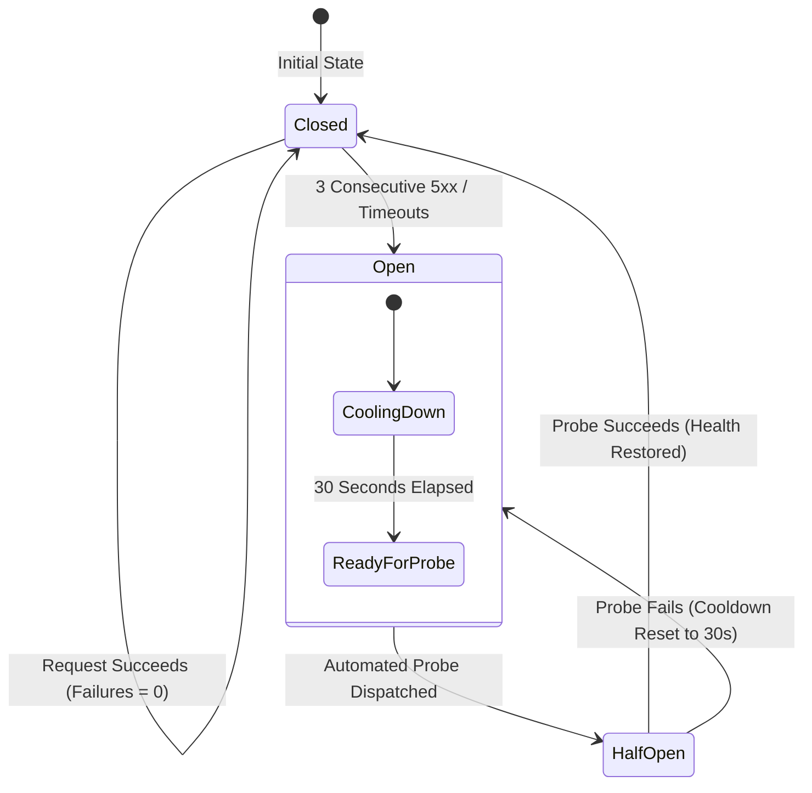

# Switchyard System Architecture

Switchyard provides a single, high-performance, private OpenAI-compatible gateway fronting locally-hosted models (Ollama on NVIDIA RTX A5000) and enterprise cloud APIs.

---

## 1. C4 Container Diagram

---

## 2. Request Sequence & Lifecycle

The sequence diagram below traces an incoming completion request through authorization, sliding-window rate limiting, cache evaluation, dynamic routing, circuit breaking, and telemetry accounting.

---

## 3. Circuit Breaker State Machine

To prevent cascading failures and request pileups on degraded nodes, each upstream backend node operates under an active circuit breaker:

- **Closed**: Requests routed normally with active health tracking.
- **Open**: Failing backend is immediately bypassed; requests automatically route to the next configured fallback in the policy chain.
- **Half-Open**: A single canary probe tests node recovery after the 30-second cooldown period.
