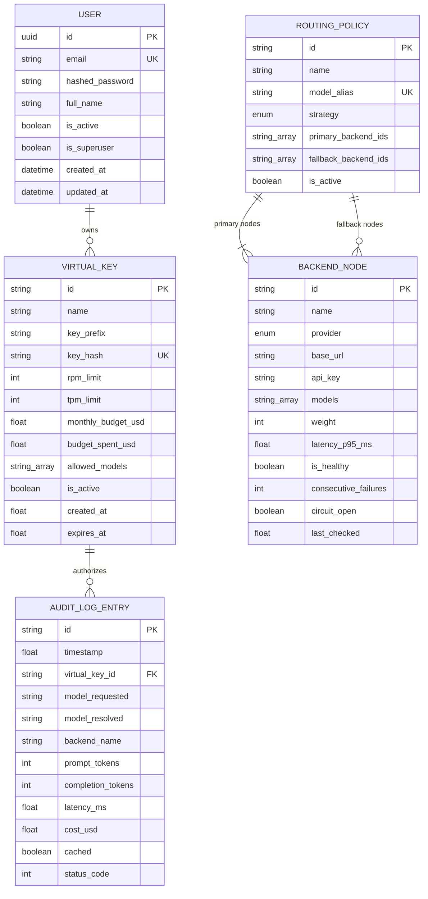

# Switchyard Data Model & Schemas

Switchyard models virtual keys, upstream routing nodes, dynamic policies, and request audit accounting.

---

## 1. Entity-Relationship Diagram (ERD)



---

## 2. Core Schemas

### Virtual Key Schema
```json
{
  "id": "key_default_admin",
  "name": "Primary Admin Virtual Key",
  "key_prefix": "sk_live_switchyard...",
  "rpm_limit": 1000,
  "tpm_limit": 200000,
  "monthly_budget_usd": 1000.0,
  "budget_spent_usd": 42.50,
  "allowed_models": ["*"],
  "is_active": true
}
```

### Routing Policy Schema
```json
{
  "id": "pol-company-default",
  "name": "Enterprise Default Route",
  "model_alias": "company-default",
  "strategy": "priority_failover",
  "primary_backend_ids": ["node-local-gpu"],
  "fallback_backend_ids": ["node-cloud-groq", "node-cloud-openai"],
  "is_active": true
}
```
